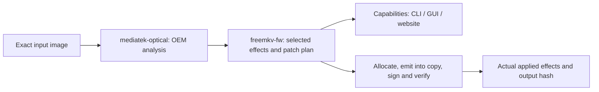

# MediaTek hook analysis and patch planning

Design for review, 2026-10-25. No implementation or additional firmware support
is enabled by this document. See the [corpus audit](../audits/mediatek-modify-hooks-20261025.md).

The acceptance criterion is every hook and patch against the entire held hoard,
not just the images currently accepted by Modify. Every input/hook pair needs
an applicable variant with verified semantics, positive not-applicable evidence,
or an explicit unresolved/refused result. A unique signature and successful
build do not certify a hook as global. Where behavior differs, select a reviewed
variant using decoded firmware evidence and record the selection. No silent
fallthrough or unclassified image is a complete audit result.

## Decision

Put read-only recognition of OEM firmware behavior in `mediatek-optical`.
Keep freemkv ABI choices, generated code, allocation, signing and public feature
policy in `freemkv-fw`. Reuse `thumb-asm` for decoding and branch mechanics.
Analyze each image once, build a complete patch plan, and apply it to a copy
only after the plan has validated. CLI, GUI and website consume that same plan's
capabilities. No model-name rules, per-image offset recipes or hash allowlists
grant support. Hashes bind evidence and plans to their exact inputs.



## Findings that change the design

### Media control is different from acceptance widening

`build_uhd_gate_stub` currently replays OEM `class == 3` for both On and OEM.
Off makes that comparison fail. It controls access to an existing native path;
it does not add a missing UHD implementation. The BD stubs behave similarly.
The separate auth-cell stub changes the `state >> 4 == 0xC` decision when On.
Those are different effects and require separate internal capabilities.

Consequently, recognizing a UHD gate is not sufficient to advertise UHD unlocking.
Likewise, a native UHD media label does not establish an available modification.
Do not remove the current support guard merely to enable the form control.

### Exact image observations

BU40N 1.00 SHA-256:
`221ad35b7edd402353e125841893ce651064e8fc6b90368fe84ff19a85a506f4`.
WH16NS58 1.V9 SHA-256:
`97b287072e20c9527de6f34f6d564c8edcc6afb3ecf5675c11b8262c11663061`.

| Property | BU40N 1.00 | WH16NS58 1.V9 |
| --- | --- | --- |
| Current media gate | explicit mode/class ladder | descriptor classifier |
| Existing BD patch site | `0x1365CE` | `0x11CED8` |
| Existing UHD patch site | `0x1365C2` | none |
| VID producer | `0x13675C` | `0x13A9CE` |
| Current auth-cell patch / candidate | `0x136826` installed | `0x13AA96` candidate only |
| State byte loaded by that check | `0x01FF9E04` | `0x01FF9E00` |
| Compared register | r0 | r1 |
| Other nearby nibble comparison | `0x136A4C` | `0x13AC68` |

The WH candidate at `0x13AA96` has this decoded sequence:

```text
0x13AA90  ldr  r1, [pc, #0x110]  ; literal resolves to 0x01FF9E00
0x13AA92  ldrb r1, [r1]
0x13AA94  lsrs r1, r1, #4
0x13AA96  cmp  r1, #0xC
0x13AA98  bne  0x13AB16
```

The branch target stores an OEM state byte and returns to the enclosing command
flow. It is not itself an inline `6F/02` sense emitter. The existing BU auth-cell
branch also targets a state-store/return path. Requiring an adjacent sense emitter
would reject the real baseline; accepting any non-erased target is too weak.
The producer, state and both continuations must be traced instead.

A deliberately broad halfword search finds **76** shift/compare/branch candidates
in WH 1.V9. Even a VID-producer-local probe finds **two**, not one. Across the
112 accepted OEM/dump inputs with a reported VID producer, the same local probe
finds two in 89 inputs and one in 23. This probe is exploratory, uses a fixed
window, and grants no support. It demonstrates why neither the first match nor
a relaxed register mask is an adequate detector.

The descriptor media gate also has a shared classifier test at `0x11CF0A`.
Patching that shared comparison as though it were UHD-specific could alter BD
and other modes. Nonzero mode must not be equated with UHD without tracing its
producer and every relevant branch.

## 1. Shared OEM analysis

Add an opt-in `analysis` feature to `mediatek-optical`, implying `image` and
an optional `thumb-asm` dependency. Its default transport/no-alloc build remains
unchanged. The already pinned thumb-asm 0.13.0 has `isa::Decoder`, `analysis::xrefs`,
`literal_value`, `reachable`, `detour` and `detour_in`; no new decoder is needed.
Check any newer API separately rather than assuming the local checkout version
is the application's dependency.

Proposed files:

```text
mediatek-optical/src/image/analysis/
  mod.rs           analysis result, errors, address types, limits
  commands.rs      validated command entries and reachable dispatch paths
  media.rs         explicit and descriptor media classification
  auth.rs          AKE, VID, reset and auth-cell roles
  region.rs        RPC emitter variants
  speed.rs         ramp and classic limiter variants
```

Use distinct file-offset, code-address and RAM-address types. Return immutable
evidence with private construction, not an unvalidated tuple of numeric offsets.
The following is an interface sketch, not code already implemented:

```rust
pub fn analyze(image: &[u8], limits: AnalysisLimits)
    -> Result<FirmwareAnalysis, AnalysisError>;

pub struct FirmwareAnalysis {
    input_sha256: [u8; 32],
    media: Resolution<MediaAccess>,
    auth: Resolution<AuthFlow>,
    region: Resolution<RpcEmitter>,
    speed: Resolution<ReadLimiter>,
}

pub enum Resolution<T> {
    Resolved(T),
    NotApplicable(ApplicabilityEvidence),
    Unavailable(UnavailableReason),
}

pub enum UnavailableReason {
    UnknownLayout,
    AmbiguousCandidates,
    UnresolvedControlFlow,
    UnexpectedInstruction,
    UnprovenStateRole,
    UnsupportedInstructionSet,
    AnalysisLimit,
}
```

The library knows OEM functions, their inputs and outputs. It does not know
`Feature::Unrestricted`, freemkv flag slots, website labels or generated stubs.

Recognition procedure:

1. Validate the image geometry and locate real command/dispatch roots.
2. Use masked signatures to propose candidates, then decode from established
   instruction boundaries. A function-start heuristic alone is not proof.
3. Build bounded reachable blocks; resolve reviewed dispatch-table forms and
   referenced literals. Record unresolved edges explicitly. Do not linearly
   decode literal pools or the second half of a wide instruction as code.
4. Prove the candidate's role through its state producer/consumer, command
   context, mode discriminator and accept/refuse continuations.
5. Record displaced instructions, live register/flag requirements, stack state,
   incoming edges and literal references. Refuse a patch span with an unhandled
   internal branch target or unknown required semantics.
6. Require exactly one semantically valid resolution per role, not exactly one
   superficial pattern match. Distinct checks in one producer remain distinct.

Limits on blocks, instructions, dispatch entries and work are part of the API.
Unknown or budget-exhausted analysis produces a typed unavailable result.

## 2. App-owned, transactional patch plans

Add `engine/hook_plan.rs` and `engine/effects.rs` to `freemkv-fw`. Initially adapt
existing finders/emissions into these types while preserving output bytes.
Then move validated read-only OEM recognizers into the shared library in small
steps. Replace optional `.Err(_) => 0` handling with recorded per-hook reasons.

Each `HookPlan` contains:

- Exact input hash and expected bytes at all modified sites.
- Semantic role and recognized variant, rather than a model/revision selector.
- Site, whole displaced instructions, branch kind, return and failure targets.
- Live registers, flags, stack obligations and supported feature states.
- Required peer hooks and code allocations, with source evidence references.

Resolve all hooks against the original immutable bytes. Allocate from the current
CMAC-covered, reservation-aware allocator, accounting for every planned site,
literal pool and prior allocation. Build all stubs before applying a group.
Reject overlaps and stale source bytes. Apply to an owned copy, sign, verify
integrity and metadata preservation, then audit branches and continuations.
Publish output and Applied status only after those checks pass.

Independent effects can still succeed independently. A feature group requiring
several hooks is atomic: a failed optional sub-hook must not leave part of that
group installed or mark the whole group Applied. No-space is a planning failure,
not a signature miss. Use `thumb-asm` detour support where its relocation contract
fits; custom semantic replacements still need explicit replay/continuation logic.
Do not place a second UHD patch over the descriptor BD patch at the same site:
plan one shared discriminator patch, or prove genuinely separate sites.

## 3. Layout-specific work

| Hook family | Required analysis and change |
| --- | --- |
| Native BD/UHD media control | Keep the explicit ladder; trace descriptor mode producers and all branches before adding equivalent refusal control. Shared classifier is not a UHD hook. |
| Auth-cell widening | Prove the first producer-local check's role and the second check's separate role. Parameterize actual value/state registers and replay obligations, with independently reviewed variants. RAM address differences alone neither grant nor deny support. |
| AKE / VID / session reset | Preserve distinct reject-only and shared accept/reject call shapes; prove the light reset primitive and AGID handling. Never substitute the heavier rearm wrapper. |
| HRL | Identify all relevant calls and shared revoke paths; retain the independent classic effect. Missing optional sites need individual reasons. |
| Region | Verify RPC response stores, frame layout and return contract. Keep fixed classic changes distinct from runtime/boot controls. |
| Speed | Model both byte-ramp register variants. The classic halfword limiter needs a separate implementation, not a larger search window. |
| Identity and boot | Resolve actual command records, init convergence and flag storage. Preserve initialization order and track the absence of boot support separately. |
| DE | Keep exact identity-byte validation and AlreadyPresent success; it does not grant unrelated modification support. |

WH 1.V9's `0x13AA96` is a candidate for an auth-cell variant, not an approved
patch site. Validate its command path and state meaning, and execute its original
and generated paths before enabling it. The descriptor UHD-control work is
separate; successfully widening this candidate does not complete that work.

## 4. One capability contract

Retain the simple public controls. Internally distinguish:

- Native media evidence.
- Fixed modification effects.
- Editable boot choices, per supported state.
- Runtime choices and whether their changes take effect in the relevant session.
- Planned, already present and actually applied effects.
- Structural, instruction-execution and hardware evidence, separately.

`BootSupport` becomes a projection of validated plans rather than a test for
nonzero stub addresses. Classic fixed Region-free/HRL can be listed without
inventing editable startup controls. Native UHD acceptance control and auth-cell
widening have distinct effect IDs; an advertised UHD modification requires the
actual promised effect. A raw-read aggregate cannot grant all its sub-features.

Provide additive, versioned `capabilities` and per-hook outcomes in Modify's JSON.
Keep existing `boot_settings` and lever fields during migration. The GUI and CLI
use the same selectable states; unsupported controls remain disabled/hidden with
readable reasons. Website generation consumes that exact-image JSON and exposes
only available modification effects. Do not duplicate the recognizers in JS.

Capability analysis must use the real build planner: a recognized site without
space for its required stub is not an available modification. Dry-run and write
must share the plan and differ only in publishing the resulting bytes.

## 5. Runtime flag compatibility

The least disruptive correction is **not** a saved-config migration or an ABI
rewrite. Keep the existing BD consumer on slot 4 initially, and make public
`SET Unrestricted` write the same value to both slots 3 and 4, as boot settings
already do. Test SET, boot, Reset-to-defaults, Reset-to-OEM and explicit Save/Restore.

Preserve deprecated raw slot-4 access for old clients. Old saved configurations
can contain different values: restore them without silently rewriting flash,
report that split state truthfully, and let the next explicit combined SET
normalize both RAM slots. Do not claim one combined runtime value while the
observed slots differ. Retiring slot 4 or changing legacy SET semantics is a
separate ABI decision; it is not required for this hook work.

## 6. Tests and rollout

1. **Capture current behavior.** Fixtures for BU40N 1.00, WH 1.V9, desktop/NB
   AKE variants, explicit/descriptor gates, classic engines and tight-space
   images. Refactoring must preserve existing supported outputs first.
2. **Recognition negatives.** Duplicate similar checks, changed literals,
   altered branch destinations, misleading data matches, split wide instructions,
   unresolved dispatch, branch into a patch span and analysis-limit exhaustion.
3. **Instruction execution.** Execute original and generated blocks for every
   public state and relevant mode/class/state value; compare OEM mode exactly.
   Check registers, flags, stack and continuation traces. Mock OEM callees with
   their validated clobber contracts. Keep the test executor external/dev-only;
   cross-check decoded instructions independently. An execution harness does not
   prove the hardware semantics of an inferred RAM byte.
4. **Plan tests.** Stale hashes/bytes, overlapping shared sites, failed peer hooks,
   no space and sign/audit failures leave the input untouched and publish nothing.
5. **Corpus gate.** Every held hash gets a classified result and hook-specific
   reason. Freeze expected variant counts and review every changed capability,
   including unexpected support losses. MK/Omni remain excluded from publication.
6. **Consumer parity.** For an exact input, GUI choices, CLI JSON, dry-run and
   website pills agree. Exercise fixed classic effects without boot support.
7. **Hardware qualification.** Keep separate from static/execution success.
   Validate native and widened paths, disc changes, OEM passthrough, persistence
   and RPC reporting on available hardware before claiming hardware confirmation.

Implementation order: behavior-preserving analysis/report contract; runtime SET
correction; WH auth-cell variant with evidence/tests; descriptor UHD control;
remaining classic/other variants; regenerated website capabilities and normal QA.
Do not batch unproven hook variants into one release merely because the corpus
builds. No new support is enabled by this design.

## Website subset: exact count and current gaps

The live website counter is **98 MediaTek model/revision entries**. That is not
the count of unique firmware BIN hashes: the catalogue contains 114 distinct
final MediaTek image hashes, including alternate packages/identities. Audit all
114, and the wider hoard, even when the UI groups them under the same revision.

Using the first listed variant for each model/revision, as the counter groups
them, the released CLI's reports give:

| Current engine result | Entries |
| --- | ---: |
| All seven advertised feature flags reported available | 24 |
| Five flags, without combined UHD/BD control | 41 |
| Limited Region/Raw-read and related fixed effects | 21 |
| Only DE/base changes, or DE already present; no listed feature hooks | 5 |
| Input refused by Modify | 7 |
| Total | 98 |

Only BU40N 1.00 in that preferred subset currently emits all nine measured
feature hooks including auth-cell widening. The seven public flags are not
nine independent hooks: AKE and Bus share an encryption control, while an
Unrestricted flag does not require evidence of auth-cell widening today.
Neither 24 complete flag sets nor one complete emitted-hook set establishes
complete semantic or physical validation.

Current displayed capabilities differ from those direct engine results:
the UI shows 23 seven-flag entries, 41 five-flag entries, 24 entries marked
modifiable without feature pills, and 10 without Modify support advertised.
There are nine preferred entries with no capability record; seven are refused
by the current engine, but **BU40N BU10** and **BH40N B7C6** do modify. The former
reports all seven flags and the latter emits classic region/raw-read/HRL effects.
This is a producer-coverage gap, not proof they are unsupported.

The new capability producer must emit a result for every published image hash,
including unsupported inputs and explicit reasons. Publishing must reject
missing records rather than interpreting their absence as unsupported. Keep
the entire hash-bound website subset inventory with the audit evidence.

## New diagnostic report

Report `cd0bd9bc-d304-466a-9c0c-659536bcd758` is app 0.15.1 on Linux,
WH16NS40 1.05. Backup read only 65,536 of 2,097,152 bytes; `0..0x1F0000`
was unreadable. Both logs record explicit `05/24/00` read rejections and no
other native sense key/ASC/ASCQ combination. The subsequent dump is incomplete:
SHA-256 `d29d65fe41cce756a397ed63e3a7b235fc50df2dfb0a71ef0defd3b65a1b8bd0`.
No Flash operation occurred. The old connection/report guidance is the read
restriction case addressed in 0.15.3, not evidence about an injected hook.
Do not approve this partial dump as distributable firmware.
